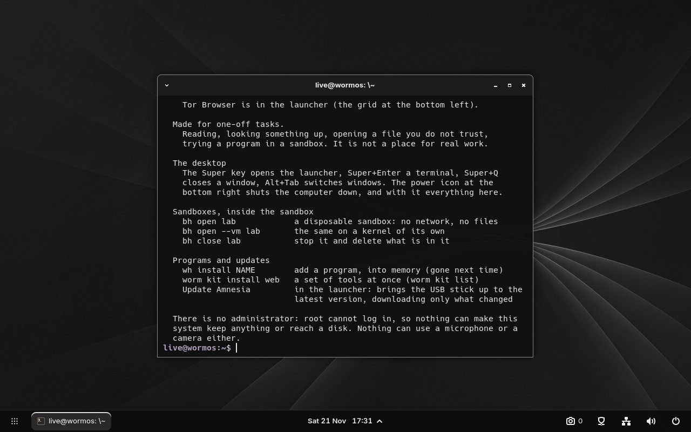

<div align="center">

# WormOS Amnesia

**A live system for one-off tasks: it runs from memory, sends every connection through Tor, and forgets everything when it stops.**

[](https://github.com/CrimsonMac/WormOS-Amnesia/actions/workflows/amnesia.yml)
[](https://github.com/CrimsonMac/WormOS-Amnesia/actions/workflows/ci.yml)
[](https://github.com/CrimsonMac/WormOS-Amnesia/releases/latest)
[](LICENSE)

[Download](https://github.com/CrimsonMac/WormOS-Amnesia/releases/latest) ·
[How it works](docs/amnesia.md) ·
[WormOS](https://github.com/CrimsonMac/WormOS) ·
[Security policy](SECURITY.md)



</div>

WormOS Amnesia is an edition of [WormOS](https://github.com/CrimsonMac/WormOS)
for the moments when you need a clean, anonymous computer for a while:
reading something, looking something up, opening a file you do not trust.
Start it from a USB stick, do the task, turn it off, and nothing of it
remains. It is not meant for real work: by design, nothing can be kept.

## What it promises

- **Nothing is kept.** Everything runs from memory; no disk is touched and
  there is no installer. At shutdown the session is deleted and its memory
  wiped. Pulling out the USB stick powers the computer off at once, the
  same way.
- **Everything goes through Tor, from the first packet.** The firewall rules
  that send all traffic to Tor and drop the rest load before the network
  comes up, and they cannot be turned off. Each destination gets its own
  Tor circuit; anything Tor cannot carry (other UDP, IPv6) is blocked.
- **There is no administrator.** Root cannot log in, so nothing can change
  the system, reach a disk or turn the protections off. Programs can still
  be installed into memory (`wh install`, `worm kit install`) for the
  session.
- **Little to identify the machine.** A random MAC address on every start
  (wired and Wi-Fi), no host name on the network, the same host name and
  UTC for everyone, no TCP timestamps, no microphone and no
  camera, and a stricter kernel (memory unreadable even to root).

## Get it

1. Download `wormos-VERSION-amnesia-x86_64.iso` and `SHA256SUMS` from the
   [release page](https://github.com/CrimsonMac/WormOS-Amnesia/releases/latest)
   and check the ISO: `sha256sum -c --ignore-missing SHA256SUMS`.
2. Write it to a USB stick as it is (`dd`, or a tool such as Ventoy or
   balenaEtcher), or boot it in a virtual machine (3 GB of memory or more;
   UEFI or BIOS, Secure Boot off).
3. Start the computer from the stick.

## Using it

- **The start screen** comes before the desktop: choose your keyboard
  layout and how to reach Tor. Directly works on most networks; where Tor
  is blocked, or using it should not be noticed, pick the Tor Project's
  snowflake, obfs4 or meek bridges, let it find bridges that work where you
  are (it asks the Tor Project, as Tor Browser's Connection Assist does), or
  paste your own. Tor waits for this
  choice, so a network that blocks Tor never sees a direct attempt.
- **The desktop** is grey, with the panel at the bottom and Tor Browser in
  the launcher. `worm anon status` shows how far Tor has connected; a
  welcome guide opens at every start. Settings (Super+I) and the panel's
  quick settings change the keyboard, mouse, sound and display for the
  session; the system itself stays locked. There is no root, and nothing
  asks for it: `worm status`, Tor bridges, a clock check and `worm panic`
  work for the live user.
- **In a virtual machine** Amnesia sets up drawing and the pointer for the
  hypervisor like WormOS, but never mounts the host's shared folders and
  runs no guest agent: nothing is kept, and the host learns nothing from
  inside the session.
- **Programs** go straight into memory: `wh install NAME`, or a whole tool
  kit with `worm kit install web` (`worm kit list`). They are gone at the
  next start, like everything else. Untrusted files open best in a
  sandbox: `bh open lab`.
- **Updates.** When a new release is out, a notification says so.
  *Update Amnesia* in the launcher (`amnesia-update`) brings the USB stick
  up to date, downloading through Tor only the parts that changed (from
  1.9 to 1.10, 8% of the ISO; from 1.10 to 1.11, a release that updated
  most packages, 37%), writing only what differs, and checks everything
  against a signature before writing.
- **A wrong clock** (an empty clock battery) is corrected from what Tor's
  relays report, so Tor still connects. Amnesia never writes the
  computer's hardware clock.

## Limits

Amnesia cannot protect against a compromised computer (firmware, hardware
keyloggers, a hostile hypervisor when it runs in a virtual machine),
against what you reveal yourself (logging in to an account identifies
you), or against attacks on Tor itself. It says so in its welcome guide;
[docs/amnesia.md](docs/amnesia.md) explains each promise, how it is kept
and what is still planned.

## How this repository works

This repository is WormOS with Amnesia on top: the `wormos-amnesia` package
([`recipes/wormos-amnesia`](recipes/wormos-amnesia)), the updater
([`src/amnesia`](src/amnesia)), the start screen in the login screen, its
plan and tests. Everything else comes from WormOS, merged regularly; its
documentation applies here too: [user guide](docs/guide.md),
[building and testing](docs/building.md), [internals](docs/internals.md).

```sh
make iso-amnesia                               # out/wormos-amnesia.iso
tests/editions-test.py amnesia                 # boot it and check every promise
make release-amnesia VERSION=1.10              # the release ISO and its signed update manifest
scripts/publish-amnesia.sh 1.10 NOTES.md       # the GitHub release (after pushing tag v1.10)
tests/amnesia-update-test.py OLD.iso NEW.iso   # check the updater (or --synthetic)
scripts/check-amnesia-release.sh DIR           # a release's ISO against its signed manifest
```

CI ([`amnesia.yml`](.github/workflows/amnesia.yml)) tests the updater on
every push and boots each release in QEMU;
[`sync-upstream.yml`](.github/workflows/sync-upstream.yml) reports WormOS
commits that are not merged here yet.

## Contributing

Bug reports are welcome as
[issues](https://github.com/CrimsonMac/WormOS-Amnesia/issues/new/choose);
problems that are not specific to Amnesia belong in
[WormOS](https://github.com/CrimsonMac/WormOS/issues). Security problems,
including any traffic that leaves without going through Tor, go through
[SECURITY.md](SECURITY.md), not public issues.

## License

Free software under the GNU General Public License, version 3 or (at your
option) any later version: see [LICENSE](LICENSE) and
[docs/legal.md](docs/legal.md). Amnesia comes with **no warranty**: it
reduces risk within the limits above; it does not make anyone anonymous
against everything.
